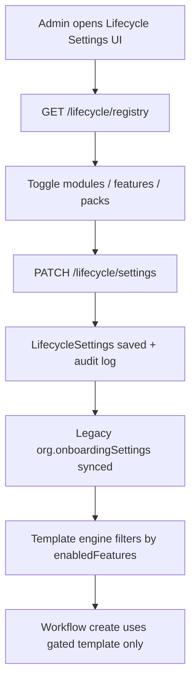

# Employee Lifecycle — Phase 0 SaaS Foundation

Enterprise configuration-driven foundation for onboarding & offboarding. All future features register in the **Lifecycle Feature Registry** and are enabled per organization via **Lifecycle Settings**.

---

## 1. Database Schema

### `LifecycleSettings` (`lifecyclesettings`)
| Field | Type | Purpose |
|-------|------|---------|
| `organizationId` | ObjectId (unique) | Tenant isolation |
| `modules.onboarding/offboarding.enabled` | Boolean | Module on/off |
| `enabledFeatures` | Map\<string, boolean\> | Per-feature flags |
| `industryPacks[]` | packKey, enabled, installedAt | Installed industry packs |
| `compliancePacks[]` | packKey, enabled, installedAt | Installed India compliance packs |
| `defaults.onboardingTemplateId` | ObjectId | Default onboarding template |
| `defaults.offboardingTemplateId` | ObjectId | Default offboarding template |
| `onboarding.*` | Boolean | Legacy bridge (auto-create, start on join) |
| `notifications` | email, inApp, push | Channel preferences |
| `reminders[]` | featureKey, daysBeforeDue, channels | Reminder rules |
| `escalations[]` | featureKey, daysAfterDue, escalateToRole | Escalation rules |
| `approvals[]` | entityType, approvalWorkflowId, enabled | Approval engine bindings |
| `documentOverrides[]` | catalogKey, mandatory, approvalRequired | Document policy overrides |

### `LifecycleFormDefinition` (`lifecycleformdefinitions`)
Custom forms with typed fields (text, number, email, phone, date, dropdown, multiselect, checkbox, radio, address, file, signature, richtext).

### `LifecycleDocumentCatalogEntry` (`lifecycledocumentcatalogentries`)
Org overrides for system document catalog (mandatory, expiry, approval, versioning).

### `OnboardingTemplate` (extended)
Added: `stages[]`, `featureKey`/`order`/`stageKey` on tasks, checklist, documents, assets, training, policies.

### `OffboardingTemplate` (new)
Stages, tasks, clearance checklist, access revocation, KT, asset rules, clearance rules, exit types, exit interview & FnF config.

### `OffboardingWorkflow` (extended)
Added: `offboardingTemplateId` reference.

---

## 2. API Design

Base: `/api/v1/admin/lifecycle`

| Method | Path | Description |
|--------|------|-------------|
| GET | `/registry` | Full snapshot: registry + settings + forms + gated docs |
| GET | `/registry/features` | Feature list only |
| GET/PATCH | `/settings` | Read/update org lifecycle settings |
| POST | `/settings/seed` | Ensure defaults for org |
| POST | `/packs/industry/install` | Install industry pack |
| POST | `/packs/compliance/install` | Install compliance pack |
| GET | `/templates/onboarding` | Feature-gated onboarding templates |
| GET | `/templates/offboarding` | Feature-gated offboarding templates |
| POST | `/templates/offboarding` | Create offboarding template |
| PUT | `/templates/offboarding/:id` | Update offboarding template |
| PUT | `/templates/onboarding/:id/stages` | Reorder/update stages (drag-drop) |
| PUT | `/templates/offboarding/:id/stages` | Reorder/update stages |
| GET | `/document-catalog?module=` | Resolved document catalog |
| GET/POST | `/forms` | List/create custom forms |
| DELETE | `/forms/:id` | Deactivate form |

Existing onboarding/offboarding workflow APIs unchanged.

---

## 3. Configuration Flow

**Install pack flow:** POST install → enable pack features → seed document catalog entries → audit.

---

## 4. Workflow Engine Design

**Single gate:** `lifecycleTemplateEngine.applyFeatureGateToTemplate()`

1. Load org `LifecycleSettings` → `resolveEnabledFeatureSet()`
2. Load template (onboarding or offboarding)
3. Filter stages, tasks, checklist, documents, assets, training, policies, clearance, KT, access by `featureKey`
4. Sort by `order`
5. Return gated template to workflow creation

No feature conditionals in controllers or UI hubs — only in the template engine.

---

## 5. Feature Registry

Location: `server/constants/lifecycleFeatureRegistry.js`

- 50+ core onboarding/offboarding features
- Extended by `lifecycleIndustryPacks.js` and `lifecycleCompliancePacks.js`
- Each feature: `key`, `label`, `module`, `category`, `defaultEnabled`, optional `dependsOn`

**Rule:** New capabilities MUST add a registry entry before implementation.

---

## 6. Permission Matrix

| Permission | HR Manager | Executive | HR Executive |
|------------|:----------:|:---------:|:------------:|
| `lifecycle.configure` | ✓ | ✓ | — |
| `lifecycle.templates.manage` | ✓ | ✓ | — |
| `lifecycle.workflow.create` | ✓ | ✓ | — |
| `lifecycle.offers.manage` | ✓ | ✓ | — |
| `lifecycle.clearance.manage` | ✓ | ✓ | — |
| `lifecycle.fnf.manage` | ✓ | ✓ | — |
| `lifecycle.compliance.manage` | ✓ | ✓ | — |
| `lifecycle.industry.manage` | ✓ | ✓ | — |
| `onboarding.manage` (legacy) | ✓ | ✓ | partial |

Org Owner receives all permissions.

---

## 7. Migration Strategy

1. Run `node server/scripts/migrateLifecycleFoundation.js`
2. For each org: create `LifecycleSettings` from `onboardingSettings`
3. Upsert default onboarding + offboarding templates with stages & featureKeys
4. Existing workflows unchanged — new creates use gated templates
5. `getOrgOnboardingSettings()` bridges to lifecycle settings

**Backward compatibility:**
- `org.onboardingSettings` still updated on lifecycle save
- Existing `OnboardingTemplate` documents without stages continue to work
- Offboarding without template falls back to gated default template
- Exit interview remains waived unless org enables `exitInterview` feature + template config

---

## 8. Seed Data

- Default onboarding template: 5 stages, 7 tasks, 10 checklist items, 10 document types
- Default offboarding template: 5 stages, 7 tasks, clearance checklist, access revocation, KT
- Default reminders & escalations in LifecycleSettings
- Approval bindings (disabled by default) for Offer, Onboarding, Offboarding, Clearance, ExitInterview, FnF, AssetReturn

---

## 9. Integrations

| System | Integration |
|--------|-------------|
| **Approval Engine** | Entity types extended: Offer, Onboarding, Offboarding, Clearance, ExitInterview, FnF, AssetReturn |
| **Audit Log** | Entity types extended; all config changes via `lifecycleAuditService` |
| **Notifications** | Channel prefs in settings; events unchanged (existing registry) |
| **Documents** | Catalog + org overrides; existing Document model unchanged |
| **RBAC** | 8 new lifecycle permissions |

---

## 10. UI Wireframe

**Route:** `/onboarding?configure=1` (Configure button inside Employee Lifecycle header — HR/admin only)

| Section | Content |
|-----|---------|
| Modules & Features | On/off modules; toggle every registry feature |
| Industry Packs | Install IT, Healthcare, Manufacturing, BFSI, Retail, Hospitality, Construction, Education |
| Compliance Packs | Install India core, tax, gratuity, labour packs |
| Templates | View gated onboarding/offboarding templates (stage & task counts) |
| Document Catalog | Resolved docs for enabled features |
| Notifications & Rules | Channels, reminders, escalations, approval bindings |

---

## 11. File Map

| Layer | Path |
|-------|------|
| Registry | `server/constants/lifecycleFeatureRegistry.js` |
| Packs | `server/constants/lifecycleIndustryPacks.js`, `lifecycleCompliancePacks.js` |
| Catalog | `server/constants/lifecycleDocumentCatalog.js` |
| Shared schemas | `server/constants/lifecycleSharedSchemas.js` |
| Models | `server/models/lifecycle.model.js`, `onboarding.model.js` |
| Services | `lifecycleConfigService.js`, `lifecycleTemplateEngine.js`, `lifecycleAuditService.js` |
| API | `server/controllers/lifecycle/lifecycleConfigController.js` |
| Routes | `server/routes/Admin/LifecycleRoutes.js` |
| UI | `vite_client/src/HR/Onboarding/LifecycleConfigurationPanel.jsx` |
| Migration | `server/scripts/migrateLifecycleFoundation.js` |
| Tests | `server/tests/unit/lifecycleTemplateEngine.test.js` |

---

## 12. Next Phases (not in Phase 0)

- Offer letter generation & candidate portal
- BGV vendor integration
- FnF payroll calculation hooks
- Drag-drop stage builder UI (API ready)
- Form builder UI (model & API ready)
- Compliance workflow automation (packs installed; flows in Phase 1+)
